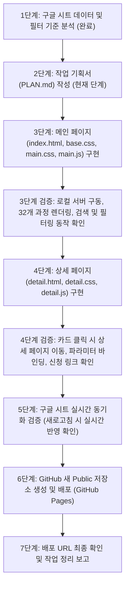

# [작업 기획서] 2026 부산대학교 직무연수 안내 웹사이트 구축 및 GitHub Pages 배포

- **작성일자**: 2026-10-23
- **프로젝트 위치**: `C:\Antigravity\Site development\2026-10-23`
- **배포 목표**: GitHub Pages (Public Repository)
- **적용 디자인 시스템**: PNU University Brand Identity & Modern Frontend Design System (반응형, 접근성, 카드 그리드, 모던 타이포그래피)

---

## 1. 프로젝트 개요

### 1.1 프로젝트 목적
부산대학교 교직원 및 실무자를 위한 **2026년도 직무연수 카탈로그(총 32개 과정)**를 효과적으로 탐색하고, 과정별 상세 정보와 신청 링크를 직관적으로 제공하는 메인·상세 2페이지 반응형 정적 웹사이트를 구축합니다.

### 1.2 핵심 구현 원칙
1. **Google Sheets 실시간 연동 (No Hardcoding)**: 데이터는 웹 호스팅 코드에 하드코딩하지 않고, 사용자가 접속할 때마다 Google Sheets의 최신 CSV 데이터를 gviz 방식으로 가져와 실시간 반영합니다.
2. **무결점 CSV 파싱**: 텍스트 필드 내 쉼표(`,`) 및 줄바꿈이 안전하게 처리되도록 `PapaParse` 라이브러리를 사용합니다.
3. **Frontend Design 가이드라인 준수**: 부산대학교 공식 아이덴티티(PNU Navy `#003876`, Sub Accent `#c8102e`)와 현대적 컴포넌트(스켈레톤 로딩, 인터랙티브 필터 칩, 반응형 카드 그리드, 상세 인포박스)를 적용합니다.
4. **단계적 검증**: 기획서 작성 -> 메인 페이지 구축 -> 상세 페이지 구축 -> 실시간 데이터 동기화 확인 -> GitHub Pages 배포 및 최종 점검을 단계별로 검증하며 진행합니다.

---

## 2. 데이터 연동 분석 및 사양

### 2.1 Google Sheets 원천 데이터 확인 결과
- **스프레드시트 ID**: `1sWeq6LCPTp0I6ith07XQizLm-KcDvAcbeNZBHkOBOvk`
- **시트 이름 / GID**: `sheet=data` (GID: `1980309032`)
- **실시간 연동 엔드포인트 URL**:
  ```text
  https://docs.google.com/spreadsheets/d/1sWeq6LCPTp0I6ith07XQizLm-KcDvAcbeNZBHkOBOvk/gviz/tq?tqx=out:csv&sheet=data&headers=1
  ```
  *(참고: 제공된 URL의 `d/d/` 중복 경로를 단일 `/d/`로 보정하고, gviz의 다중 헤더 그룹핑 이슈를 방지하기 위해 `&headers=1` 파라미터 적용 확인 완료)*
- **실시간 갱신 보장**: 브라우저 캐싱 방지를 위해 호출 시 `&_t=${Date.now()}` 타임스탬프 쿼리를 추가합니다.

### 2.2 수집 데이터 컬럼 스키마 (총 17개 항목)
| 번호 | 컬럼명 | 설명 / 형식 예시 | 활용처 |
|:---:|:---|:---|:---|
| 1 | **과정코드** | `PNU-2026-001` ~ `PNU-2026-901` (고유 키) | 상세 페이지 URL 파라미터 (`?code=...`) |
| 2 | **과정명** | 직장 내 성희롱·성폭력 예방 교육, AI 부트캠프 등 | 카드 타이틀, 상세 타이틀, 검색 대상 |
| 3 | **분야** | 법정의무교육(6), 정보화·AI·데이터(4), 대학행정 특화(6) 등 10개 분야 | 1차 대분류 필터 탭 |
| 4 | **대상** | 전 직원(11), 실무자(16), 관리자(4), 신규자(1) | 대상별 필터 드롭다운 / 태그 |
| 5 | **이수구분** | 필수(6), 권장(8), 선택(17), 필수(해당자)(1) | 배지 표시 및 하이라이트 필터 |
| 6 | **교육방식** | 온라인(8), 집합(22), 혼합(2) | 교육형태 필터 및 아이콘 |
| 7 | **교육시간** | 1시간, 6시간, 8시간, 24시간 등 | 과정 요약 칩 |
| 8 | **정원** | 무제한, 30명, 25명 등 | 수강 정원 안내 |
| 9 | **교육기간** | 상시(2026-01-02~12-31), 2026-03-16~03-17 등 | 일정 안내 태그 |
| 10 | **신청기간** | 상시, 2026-03-02~03-11 등 | 신청 가능 여부 상태 표시 |
| 11 | **담당부서** | 인재개발원, 정보화본부, 재무과, 총무과 등 11개 기관 | 부서 필터 및 담당 안내 |
| 12 | **한줄소개** | 핵심 요약 설명 문구 | 메인 페이지 카드 본문 |
| 13 | **상세소개** | 배경, 근거 법령, 교육 상세 개요 | 상세 페이지 본문 영역 |
| 14 | **학습목표** | 가운뎃점(`·`)으로 구분된 3~4개 목표 | 상세 페이지 체크리스트 UI |
| 15 | **주요내용** | 커리큘럼 핵심 목차 | 상세 페이지 타임라인/모듈 카드 UI |
| 16 | **신청링크** | `https://hrd.pusan.ac.kr/course/PNU-2026-xxx` | 수강신청 바로가기 CTA 버튼 |
| 17 | **문의** | 담당부서 및 내선번호 (예: `인재개발원 051-510-1231`) | 문의처 안내 카드, 전화걸기 링크 |

---

## 3. 폴더 구조 및 파일 구성

```text
C:\Antigravity\Site development\2026-10-23/
│
├── index.html              # 메인 페이지 (직무연수 카탈로그 개요, 검색, 다중 필터, 카드 그리드)
├── detail.html             # 상세 페이지 (선택된 연수 상세 정보, 학습목표, 커리큘럼, 신청 링크)
│
├── css/
│   ├── base.css            # 리셋, PNU 컬러 시스템, 타이포그래피(Pretendard), 공통 레이아웃
│   ├── main.css            # 메인 페이지 전용 스타일 (Hero, 필터 칩, 카드 그리드, 스켈레톤)
│   └── detail.css          # 상세 페이지 전용 스타일 (브레드크럼, 인포박스, 타임라인, CTA 카드)
│
├── js/
│   ├── api.js              # Google Sheets gviz CSV fetch + PapaParse 공통 파서 및 캐시 관리
│   ├── main.js             # 메인 페이지 로직 (검색 디바운스, 다중 필터링, 정렬, 렌더링)
│   └── detail.js           # 상세 페이지 로직 (URL 파라미터 파싱, 상세 데이터 바인딩, 관련 과정 추천)
│
├── assets/
│   └── pnu_logo.svg        # 부산대학교 공식 심볼 및 로고
│
├── PLAN.md                 # 본 작업 기획서
└── README.md               # 저장소 설명 및 배포 안내 문서
```

---

## 4. 페이지별 구성 요소 및 기능 단위 분해

### 4.1 메인 페이지 (`index.html`)

```
+--------------------------------------------------------------------------+
|  [PNU Logo] 부산대학교 직무연수 지원센터                   [실시간 데이터 갱신]  |
+--------------------------------------------------------------------------+
|  [Hero Banner]                                                           |
|  2026학년도 부산대학교 교직원 직무연수 통합 안내                          |
|  전문성과 미래 역량을 키우는 맞춤형 직무 역량 강화 프로그램               |
|                                                                          |
|  [ 요약 지표 카드: 전체 32개 과정 | 법정필수 7개 | 온라인상시 8개 | 모집중 ]     |
+--------------------------------------------------------------------------+
|  [검색 및 통합 필터 콘솔]                                                 |
|  [ 🔍 과정명, 담당부서, 키워드 검색...                              ]     |
|                                                                          |
|  - 분야: [전체] [법정의무] [정보화·AI] [대학행정] [직무공통] [예산회계]...  |
|  - 이수구분: [전체] [필수] [권장] [선택]                                 |
|  - 교육방식: [전체] [온라인] [집합] [혼합]                               |
|  - 대상:     [전체] [전 직원] [실무자] [관리자] [신규자]                 |
|  - 정렬:     [기본순 / 교육시간순 / 과정코드순]                           |
+--------------------------------------------------------------------------+
|  검색 결과: 총 32개 과정이 조회되었습니다.                                |
|  +-------------------+  +-------------------+  +-------------------+     |
|  | [법정의무] [필수]  |  | [정보화·AI] [선택] |  | [대학행정] [권장]  |     |
|  | PNU-2026-001      |  | PNU-2026-401      |  | PNU-2026-501      |     |
|  | 성희롱·성폭력 예방|  | AI 부트캠프        |  | 학사행정 실무     |     |
|  | ----------------- |  | ----------------- |  | ----------------- |     |
|  | ⏱ 1시간 | 💻 온라인|  | ⏱ 24시간| 👥 혼합  |  | ⏱ 8시간 | 🏫 집합  |     |
|  | 🏢 인재개발원      |  | 🏢 정보화본부      |  | 🏢 교무과          |     |
|  | [상세보기 ->]     |  | [상세보기 ->]     |  | [상세보기 ->]     |     |
|  +-------------------+  +-------------------+  +-------------------+     |
+--------------------------------------------------------------------------+
|  Footer: 부산대학교 인재개발원 · 개인정보처리방침 · 문의안내                |
+--------------------------------------------------------------------------+
```

#### 기능 단위 분해:
1. **F1. 실시간 데이터 페칭 & 캐시 관리 (`api.js`)**:
   - `fetchGoogleSheetData()`: gviz CSV 요청 -> PapaParse 파싱 -> JavaScript 객체 배열 반환.
   - 로딩 상태 관리: 스켈레톤 카드 6개 노출.
   - 오류 발생 시 알림 배너 및 재시도 버튼 제공.
2. **F2. 통합 검색 엔진 (Search Engine)**:
   - 검색창 입력 시 200ms 디바운스 적용.
   - 과정명, 한줄소개, 담당부서, 주요내용 대상 다중 필드 부분 일치 검색.
3. **F3. 다차원 필터링 시스템 (Multi-faceted Filter)**:
   - **분야(Category)**: 상단 수평 스크롤 칩 (10개 분야).
   - **이수구분(Requirement)**: `필수`, `권장`, `선택`.
   - **교육방식(Method)**: `온라인`, `집합`, `혼합`.
   - **대상(Target)**: `전 직원`, `실무자`, `관리자`, `신규자`.
   - 다중 조건 교집합(AND) 필터링.
4. **F4. 결과 카드 렌더링 & 인터랙션**:
   - 이수구분 배지 컬러링 (필수: Crimson Red, 권장: Ocean Blue, 선택: Neutral Grey).
   - 호버 시 카드 리프트 효과 및 그림자 전환.
   - 카드 클릭 시 `detail.html?code=${item['과정코드']}`로 매끄럽게 전환.
5. **F5. 공백 상태 (Empty State)**:
   - 검색/필터 조건에 부합하는 결과가 없을 시 직관적인 안내 아이콘 및 "필터 초기화" 버튼 노출.

---

### 4.2 상세 페이지 (`detail.html`)

```
+--------------------------------------------------------------------------+
|  [PNU Logo] 부산대학교 직무연수 지원센터                   [< 전체 과정 목록] |
+--------------------------------------------------------------------------+
|  홈 > 직무연수 카탈로그 > [분야명] > [과정코드]                           |
|                                                                          |
|  [Header Banner]                                                         |
|  [분야 칩] [이수구분 칩] [교육방식 칩]       과정코드: PNU-2026-401         |
|  <h1>AI 부트캠프: 생성형 AI 직무 실무 활용</h1>                            |
|  <p>현업에 바로 적용하는 ChatGPT·Claude 업무 적용 8주 집중 과정</p>        |
+--------------------------------------------------------------------------+
|  [주요 정보 요약 그리드 (6-Grid Metrics)]                                 |
|  - 교육시간: 24시간 (8주)            - 교육방식: 혼합(온라인+실습)         |
|  - 수강대상: 전 교직원               - 수강정원: 30명 선착순              |
|  - 교육기간: 2026-06-15~08-07        - 신청기간: 2026-05-25~06-12         |
+--------------------------------------------------------------------------+
|  [메인 콘텐츠 영역 (2:1 구조)]                                             |
|  << 좌측 본문 >>                      << 우측 사이드바 (Sticky) >>        |
|  1. 과정 상세 소개                    +--------------------------------+  |
|     - 근거 및 교육 취지                | [ 🚀 수강신청 바로가기 (외부) ]  |  |
|     - 기대 효과                       +--------------------------------+  |
|  2. 핵심 학습 목표 (Checklist)        | [담당부서 및 문의]              |  |
|     - [v] 목표 1                      |  담당: 정보화본부              |  |
|     - [v] 목표 2                      |  전화: 051-510-2010            |  |
|  3. 주요 교육 커리큘럼                |  이메일: it-hrd@pusan.ac.kr    |  |
|     - 모듈 1 / 모듈 2                 +--------------------------------+  |
|                                       | [공유 및 인쇄]                 |  |
|                                       |  [URL 복사] [과정 개요 인쇄]    |  |
|                                       +--------------------------------+  |
+--------------------------------------------------------------------------+
|  [하단 추천 섹션: 같은 분야의 다른 추천 과정]                              |
|  +-------------------+  +-------------------+  +-------------------+     |
|  | 추천 연수 1       |  | 추천 연수 2       |  | 추천 연수 3       |     |
|  +-------------------+  +-------------------+  +-------------------+     |
+--------------------------------------------------------------------------+
```

#### 기능 단위 분해:
1. **D1. 파라미터 해석 및 데이터 매칭**:
   - `new URLSearchParams(window.location.search).get('code')`로 과정코드 식별.
   - 구글 시트 데이터에서 해당 코드 검색, 데이터가 없을 경우 메인 목록 이동 유도.
2. **D2. 반응형 메트릭 인포박스**:
   - 교육시간, 교육방식, 대상, 정원, 교육기간, 신청기간을 현대적인 타일형 그리드로 렌더링.
3. **D3. 학습목표 및 주요내용 파싱 분해**:
   - 시트의 가운뎃점(`·`) 구분 텍스트를 구조화된 `li` 체크리스트 및 단계별 뱃지 아이템으로 변환.
4. **D4. 원스톱 CTA (Call-to-Action)**:
   - "수강신청 바로가기" 버튼 클릭 시 시트 내 `신청링크` URL로 새 탭 열기 (`target="_blank"`, `rel="noopener noreferrer"`).
   - 문의처 전화번호 클릭 시 모바일 기기 즉시 통화 연결 (`tel:051...`).
5. **D5. 연관 과정 추천 (Related Courses)**:
   - 동일한 '분야'에 속한 다른 연수 과정을 최대 3개까지 자동 추천하여 연속 탐색 지원.

---

## 5. Frontend-Design 스킬 기반 디자인 시스템 명세

### 5.1 Color Palette
- **PNU Navy (Primary Brand)**: `#003876` (신뢰, 공공성, 부산대학교 메인 컬러)
- **PNU Crimson (Accent Brand)**: `#c8102e` (필수 법정교육, 주요 알림)
- **PNU Light Blue (Sub Accent)**: `#0072ce` (인터랙션 호버, 링크)
- **Neutral Dark (Heading & Text)**: `#0f172a` (선명한 명도 대비)
- **Neutral Muted (Body & Meta)**: `#475569` (부드러운 본문)
- **Surface / Background**: `#f8fafc` (눈의 피로도를 낮추는 미색 배경)
- **Card Background**: `#ffffff` (부드러운 그림자 `0 4px 6px -1px rgba(0, 0, 0, 0.05)`)

### 5.2 Typography & Spacing
- **Font-family**: `'Pretendard', -apple-system, BlinkMacSystemFont, system-ui, Roboto, sans-serif`
- **Typographic Scale**:
  - Hero Title: `2.25rem` (36px), Bold
  - Section Title: `1.5rem` (24px), Semi-bold
  - Card Title: `1.125rem` (18px), Semi-bold
  - Body: `0.9375rem` (15px), Regular
  - Caption / Tag: `0.8125rem` (13px), Medium
- **Container Max-Width**: `1200px` 중앙 정렬.

### 5.3 UI/UX Micro-Interactions
- 카드 호버 시 `transform: translateY(-4px)`, `box-shadow` 확장.
- 필터 칩 전환 시 부드러운 배경색 전환 (`transition: all 0.2s ease`).
- 스켈레톤 로딩 애니메이션 (`shimmer` 키프레임 효과).

---

## 6. 단계별 작업 및 검증 계획



### 상세 진행 프로세스:
- **[진행완료] 1단계**: Google Sheets CSV API 연동 엔드포인트 검증 (`headers=1`), 32개 과정 및 17개 컬럼 데이터 확인, 부산대 CI 에셋 확보.
- **[진행완료] 2단계**: 작업 기획서 (`PLAN.md`) 작성 완료.
- **[다음단계] 3단계**: `index.html`, `css/base.css`, `css/main.css`, `js/api.js`, `js/main.js` 제작 및 로컬 서버에서 검색·필터·카드 렌더링 검증.
- **[예정] 4단계**: `detail.html`, `css/detail.css`, `js/detail.js` 제작 및 상세 정보 파싱, 관련 과정 추천 로직 검증.
- **[예정] 5단계**: 시트 데이터 실시간 반영 테스트.
- **[예정] 6단계**: GitHub 저장소 생성, 소스 푸시, GitHub Pages 활성화.
- **[예정] 7단계**: 최종 서비스 배포 URL 및 결과 요약 보고.

---

*본 기획서에 명시된 구조와 디자인 시스템을 기반으로 즉시 3단계 메인 페이지 구축을 시작합니다.*
